# What the queues look like, from every service

Before an experiment that has to wait in a vendor's queue, the queues
themselves: how long they are, when they are short, how fast they move,
and whether the same machine looks the same from AWS Braket and from IonQ's
own API. Nothing is submitted. The queue is read at intervals, which is
free and is what every user of the device sees, so the sampler runs for
days.

What comes out:

- **a distribution per device**, overall and by hour of day and weekday,
  which is when to run the weekend's experiments and what the mock should
  draw its waits from
- **whether Braket and IonQ report one machine the same way**: Braket's
  count of tasks waiting against IonQ's average queue time, at the same
  tick and at lags, and whether they agree the machine is up
- **how the queue moves**: how often the depth rises, falls and sits
  still, and the steepest sustained fall, which is a lower bound on how
  fast the device clears tasks. That, with IonQ's queue time, is what
  turns a depth into a wait for the mock

## Findings, 14 to 18 October 2026

Four days of samples, one a minute, from Wednesday 19:10 to Sunday 19:09
UTC. That is 68,544 rows with zero errors, twelve machines through three
services, and nothing submitted. The tables are in `results/analysis.txt`, the per device
distribution in `results/distribution.json`, and every row keeps the full
response of the call it came from.

### When each machine was taking work

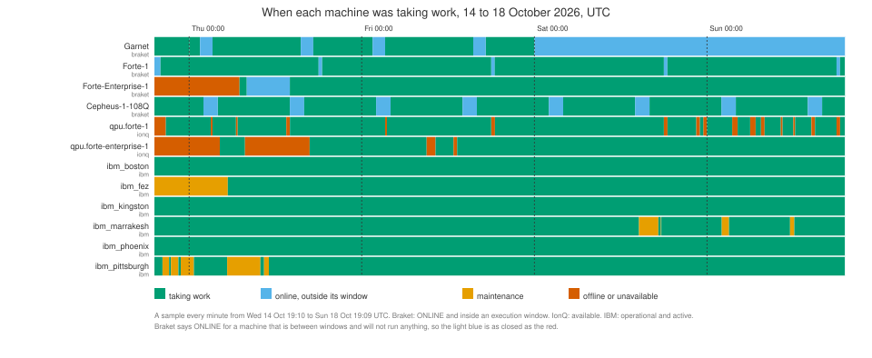

- **Braket's ONLINE is not "taking work".** Cepheus closes twice a day for
  two hours, Garnet runs on weekdays only and sat closed from Saturday
  00:00 for the last 43 hours of the run, and Forte-1 closes every day
  from 18:00 to 18:30 UTC. All three say ONLINE throughout. Only the
  execution windows in the device properties say otherwise, so a scheduler
  reading status alone would submit into a machine that is not running.
- **Forte-Enterprise-1 was OFFLINE on Braket for the first twelve hours**,
  until 07:00 UTC Thursday, then ONLINE for the rest of the run. It was
  ONLINE but outside its execution window from 08:00 to 14:00 Thursday,
  so it was taking work 81% of the time. IonQ showed it unavailable from
  the start until 04:15 Thursday, again from 07:45 to 16:45 Thursday, and
  twice briefly on Friday.
- **IonQ reports more downtime than Braket for the same machine.**
  Forte-1 was available 91% of the time through IonQ and taking work 97%
  through Braket, meaning ONLINE and inside an execution window. IonQ had
  sixteen unavailable spells, twelve of them half an hour or less. Some
  match Braket's daily 18:00 window closure, and several fell on Sunday
  morning while Braket's count of waiting tasks kept growing.
- **IBM backends go into maintenance in short spells.** Pittsburgh five
  times on Wednesday and Thursday, marrakesh four times over the weekend,
  fez for its first ten hours. Boston, kingston and phoenix were active the
  whole run.

### Every queue, over the four days

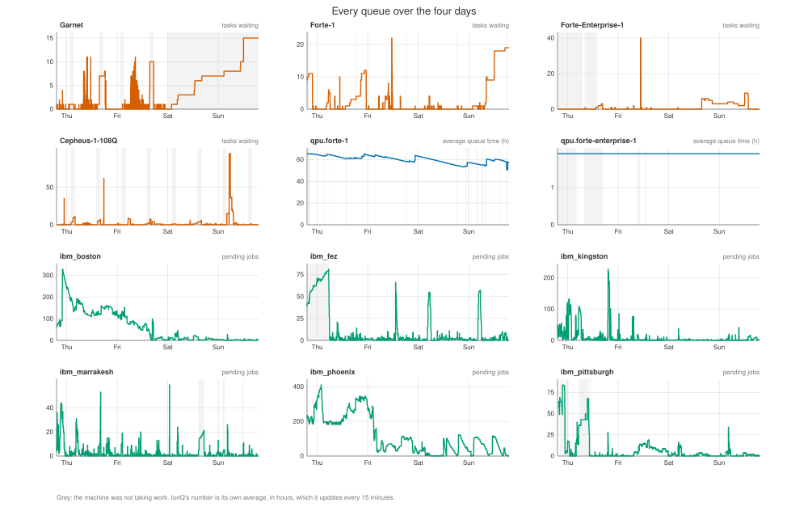

- **The Braket machines are empty most of the time they are open.** Counted
  only over the minutes each machine was taking work, Forte-1's queue was
  zero on 63% of them, Forte-Enterprise-1's on 66%, Cepheus's on 74% and
  Garnet's on 84%. Forte-1's 90th percentile while open is 11 tasks and its
  worst minute 22.
- **Queues build both while a machine is open and while it is shut, and
  which one depends on the machine.** Forte-1's queues came while it was
  open, 92 of every 100 queued minutes, and seven of its eight episodes of
  five or more tasks began while it was open. Garnet is the opposite. It
  was empty on 84% of its open minutes and on 5% of its shut ones, and its
  one long queue, five or more tasks for 30 hours over the weekend, built
  entirely while it was closed and cleared within minutes of opening. On
  IBM, fez and pittsburgh carried their largest queues during maintenance,
  a mean of 65 and 41 pending jobs against 4 while active. A queue on a
  shut machine is demand waiting for the door, not load.
- **Cepheus took 95 tasks at once** at 05:10 on Sunday and cleared them in
  two hours.
- **Two IBM backends carry the load.** Boston held 50 or more pending jobs
  for 40 hours straight with a peak of 328, phoenix for 33 hours with a peak
  of 410. Kingston, fez, marrakesh and pittsburgh have a median of one job or
  none, with spikes. Kingston reached 227 and fell from 189 to 8 in ten
  minutes.

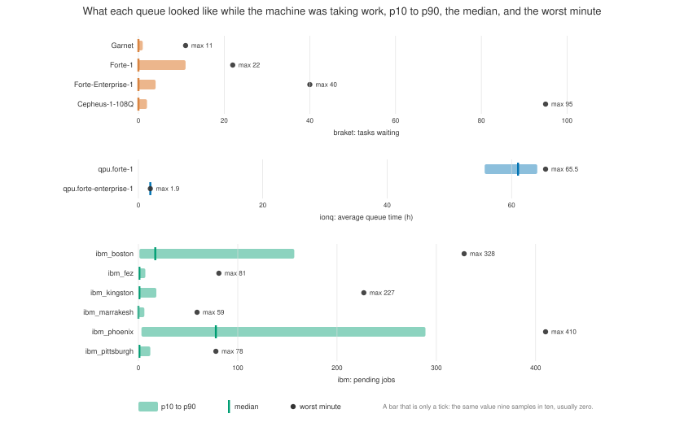

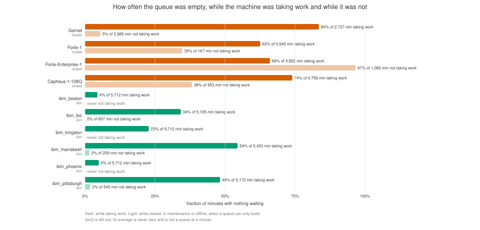

### The same machine as Braket reports it and as IonQ reports it

Forte-1 is one machine. Braket reports its queue as a count of waiting
tasks, IonQ as an average queue time. Those cannot share an axis, so the
third panel ranks each minute against the rest of its own series. On that
panel 0 is the emptiest minute that service ever showed Forte-1 and 100
the busiest, and a count and a time can sit on one axis.

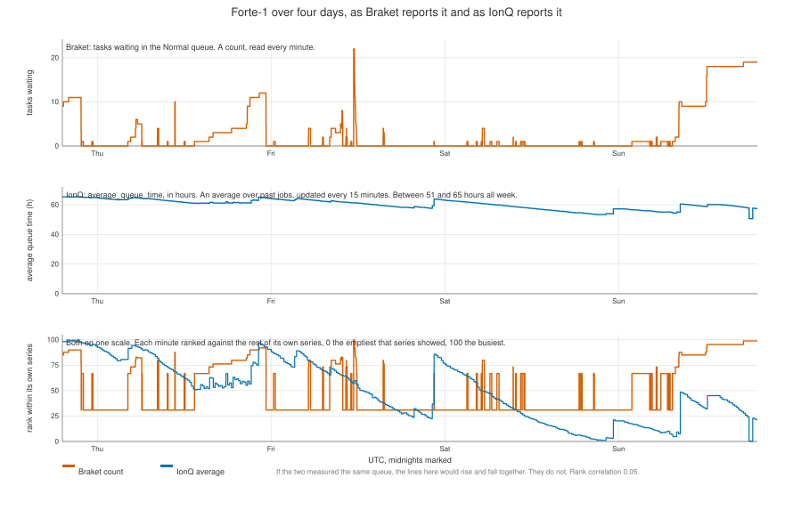

- **Braket's count and IonQ's average are not the same thing.** Braket's
  number changes minute to minute. IonQ's `average_queue_time`
  updates every fifteen minutes and moves slowly. IonQ's docs call it the
  current wait time and type it as a unix timestamp with no unit. We read
  it as milliseconds, the only unit that gives a plausible wait. Forte-1
  went from 65 hours to 57 hours over the whole run, and Forte-Enterprise-1
  reported the same 1.9 hours for four days without changing once.
  Whatever it measures, it does not track the queue minute to minute. The rank correlation between the two for Forte-1 is 0.05 at
  the same minute and no better at any lag.
- **For timing anything, Braket's count is the signal**, for the
  IonQ-direct experiments as much as the Braket ones. IonQ's number says
  how long recent jobs waited on average, which is a different and much
  larger quantity.
- **They do agree the machine is up** on 93% of the minutes where either
  says so.

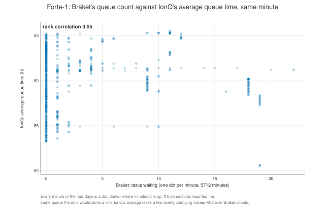

### The one long queue, Sunday on Forte-1

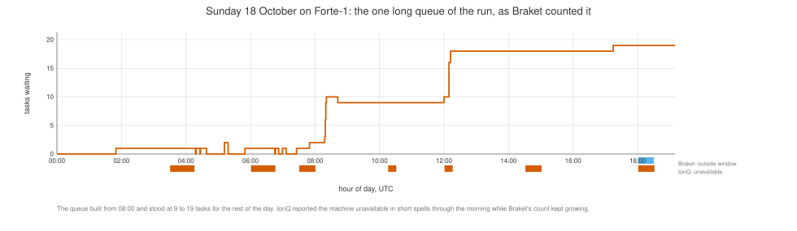

The queue built from 08:00 and stood between 9 and 19 tasks for the rest
of the day, the only sustained contention on Forte-1 in four days. The
other episodes of five or more tasks lasted under three hours. Natural
contention on Forte-1 is rare, so an experiment that needs it either waits
for a day like this or makes its own with filler tasks.

### By hour of day

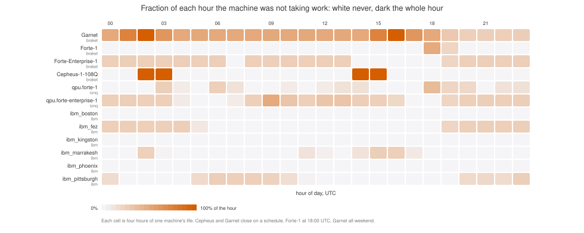

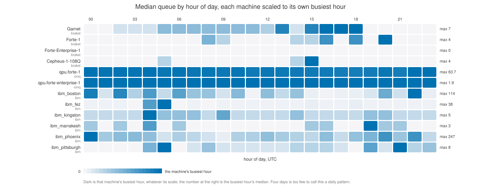

The closures are regular. Cepheus closes at 02:00 and 14:00, Garnet at
01:30 and 15:30 on weekdays, Forte-1 at 18:00. The queues show no pattern worth
trusting from four days. Each cell is about four hours of one machine's
life, and one Sunday afternoon moves Forte-1's whole row.

### How fast the queues move

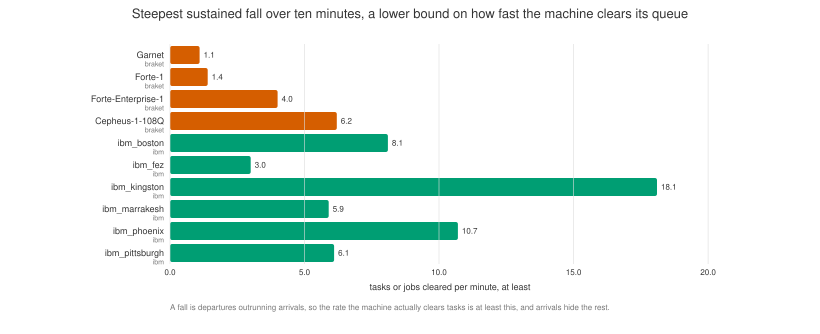

A fall in the depth is departures outrunning arrivals, so the steepest
sustained fall is a lower bound on how fast the machine clears tasks, and
arrivals hide the rest. Forte-1 cleared at least 1.4 tasks a minute,
Cepheus 6, the IBM backends 3 to 18 jobs a minute. IBM jobs are short.

### When the published properties change

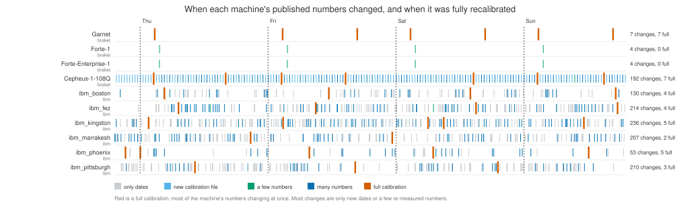

Every sample carries the device's full record, stored in full whenever it
changes. The usual experience on these machines is that the qubits drift
between calibrations, so a job that runs late in a window is likely on
noisier qubits than the published fidelities say. These samples do not
measure that drift. What they give is the length of each window, which
is how far from a calibration a job can find itself. IBM republishes calibration every seven to thirteen minutes,
which is why kingston has 298 versions in four days. Braket's IonQ devices
publish once a day at 03:38 UTC, and what changes is the two qubit and SPAM
fidelity means. Cepheus publishes every 30 minutes.

### Other things the data says

- **Forte on Braket costs $0.08 a shot with a minimum of 100 shots**, read
  from the device properties, so the cheapest possible task is $8.30, not
  the 33 cents assumed before. The Forte experiment's live estimate reads
  this, and its offline fallback has been corrected to match.
- **The Priority queue on Forte-1 was empty for the entire four days**, and
  no hybrid job was queued or running on it. A hybrid job hold would have
  had the Priority queue to itself. Cepheus showed one prioritised task on
  Friday, someone else's hybrid job.
- **IonQ's backend record for Forte-Enterprise-1 has a `kw` field**,
  between 4.57 and 4.62, that Forte-1's does not. It is in the raw rows.

### What this means for the experiments

- Use Braket's live count to time a run or to say what the queue was, on
  every path to Forte. Do not use IonQ's average for that.
- Contention on Forte-1 has to be made. Filler tasks, or a Sunday.
- Count a queue only over the minutes the machine is taking work. An
  empty queue on a shut machine is not an idle machine, and a queue that
  built while it was shut is the first thing the machine will do when it
  opens, so a job routed there starts behind it.
- For QRMI on IBM, kingston and marrakesh are the quiet machines, phoenix
  and boston have contention for free.
- The mock's queue depth for a Forte-like device is mostly zero with a
  tail to about twenty. The quantiles are in `results/distribution.json`.
  Converting a depth to seconds needs a service time this data does not
  give, since nothing was submitted. The drain rates are the lower bound.
- Four days is enough for the closures and the Braket against IonQ
  comparison, not for a weekday or hour-of-day pattern.

The figures are SVG drawn by `scripts/figures.py` with nothing installed,
from the same rows. [plots/index.html](plots/index.html) is the browsable
version. It has ten tabs, each with a short account of what the view shows
and what it means, and every chart has hover. There is an overview, the
method, the calendar, every queue with machine toggles, Forte-1 as Braket
and IonQ report it with a linked cursor, any single day for any machine,
the two heat maps by hour, spread and drain, calibration changes, and the
table. Open it in a browser. It needs no server and loads nothing from the
network.

## What each service tells you

| vendor | call | the analysis uses | cost |
|--------|------|-------------------|------|
| Braket | `AwsDevice.queue_depth()`, device metadata | tasks waiting in the Normal and Priority queues, hybrid jobs waiting, ONLINE, inside an execution window | free |
| IonQ | `GET /backends` | `average_queue_time`, read as milliseconds, `status`, `degraded` | free |
| IBM | `QiskitRuntimeService.backends()`, `status()` | `pending_jobs`, `operational`, `status_msg` | free |

Those are the fields the tables read. Every row also keeps the whole
response of the call it came from, under `raw`, and how long each call
took, under `elapsed_s`. Nothing a service returned is thrown away. A
device's full properties, the calibration and configuration record that
Braket and IBM send back with every call, is kept in full in the row where
it first appeared and again whenever it changes, under `properties`, and
every row carries the digest of the version in force. Errors keep the
whole exception.

Each vendor reports a different thing, a count, a time, a count, so they
are never put on one axis. The paired machines are compared by rank, which
needs no units.

A session's own queue is not visible from outside on any of them.
Braket's hybrid job token puts a task in the Priority queue, whose length
Braket does report. So the Priority count is in every Braket sample. How
long a task of ours would wait in either queue is a later experiment's
business, and not this one's: submitting tasks to time them would measure
one task on one day, which varies with everything and proves little.

## Setup

Credentials in the environment for whichever vendors you want. A vendor
without them is skipped, not failed.

```bash
export AWS_ACCESS_KEY_ID=... AWS_SECRET_ACCESS_KEY=...       # or ~/.aws/credentials
export IONQ_API_KEY=...
export IBM_CLOUD_TOKEN=... IBM_CLOUD_CRN=...                  # or QISKIT_IBM_TOKEN and QISKIT_IBM_INSTANCE
pip install amazon-braket-sdk qiskit-ibm-runtime             # IonQ needs nothing beyond the key
bash preflight.sh 2>&1 | tee preflight.log
```

Preflight takes one tick from every vendor and prints it, and checks the
paired machines in `devices.json` are in the sampled lists. `devices.json`
is the list: the Forte and Aria machines as Braket and IonQ report it, two more
Braket QPUs, and an empty IBM list that means every backend the instance
can see.

## Running

```bash
nohup bash run.sh > results/run.log 2>&1 &                    # 4 days, every 60s
DAYS=3 INTERVAL=30 nohup bash run.sh > results/run.log 2>&1 &
```

It appends to `results/queues.jsonl`, so a restart carries on in the same
file. When the days are up, or it is killed, it runs the analysis into
`results/analysis.txt` and `results/distribution.json` and the figures
into `plots/`.

Run it anywhere with the credentials and the packages. A cluster node is
fine, so is a laptop that stays awake. One sampler at a time per file.

## Reading it

```bash
python3 scripts/analyze.py results/queues.jsonl --tz -7
python3 scripts/plot.py results/queues.jsonl --tz -7
python3 scripts/figures.py results/queues.jsonl              # the SVG figures, no matplotlib needed
```

`--tz` puts the hour of day table in local time. The tables:

- **each device**: samples, days, how often it was taking work, and the
  p10, p50, p90 and max of its measure
- **the queue while taking work, against while not**: how often each
  queue was empty and its mean, split by whether the machine was open
- **median by hour of day and by weekday**: when to run
- **the same machine through Braket and through IonQ**: paired ticks, the
  rank correlation at the same tick and at the lag where it is strongest, a
  positive lag meaning IonQ's number trails Braket's, and how often they
  agree the machine is up
- **how the queue moves**: rising, falling and flat ticks, and the
  steepest sustained fall in tasks per minute

The figures, one y axis per panel:

| figure | what |
|--------|------|
| `cal-status` | a calendar of every machine's state over the run |
| `queues-timeline` | every queue over the run, one panel each |
| `forte1-braket-vs-ionq` | Forte-1 as Braket and as IonQ report it, and both ranked against themselves on one axis |
| `forte1-agreement` | Braket's count against IonQ's average, same minute |
| `forte1-sunday` | the Sunday queue on Forte-1 |
| `closed-hours`, `queue-hours` | by hour of day: fraction not taking work, median queue |
| `queue-ranges`, `empty-fraction`, `drain` | each queue's spread, how often empty, steepest fall |
| `calibration` | when each machine's published properties changed |
| `index.html` | the same data with hover and machine toggles, from `scripts/page.py` |

`results/distribution.json` has, per device, the quantiles, every value
sorted, the quantiles by hour, the availability, and the movement. That
is what the mock experiment reads to draw its waits from, and what the
weekend's device experiments use to pick their hours.

## Rehearsing

`scripts/synthetic.py` writes a made up three days with a daytime swell,
and a planted lag between Braket and IonQ, so the analysis and figures can
be checked before the real samples exist. The analysis recovers the lag.

```bash
python3 scripts/synthetic.py --out results-synthetic/queues.jsonl
python3 scripts/analyze.py results-synthetic/queues.jsonl
python3 scripts/plot.py results-synthetic/queues.jsonl --out plots-synthetic
```

The IonQ reader can be rehearsed against the fake service, which reports an
`average_queue_time` from its `FAKE_IONQ_QUEUE` range:

```bash
FAKE_IONQ_QUEUE=30-90 flux python -m flux_quantum.backends.ionq.fake --port 0 &
IONQ_API_KEY=x IONQ_API_URL=http://127.0.0.1:<port> python3 scripts/sample.py --once --vendors ionq
```

## What would be a finding

- Braket's count and IonQ's average rank the same way with a small lag:
  one queue, two views, and either can be used to pick a time. If they do
  not, the two services describe different things and the later comparison
  of the two paths has to say which queue it waited in. (They do not; see
  the findings above.)
- A clear hour of day pattern: the experiments run in the trough, and the
  mock's distribution is sampled by hour rather than flat.
- The steepest fall against IonQ's average: if Braket and IonQ agree, the
  seconds per task ahead on Forte follow from the free data alone, and
  that is the mock's service time, which the coscheduling experiments'
  cores held numbers scale with.
